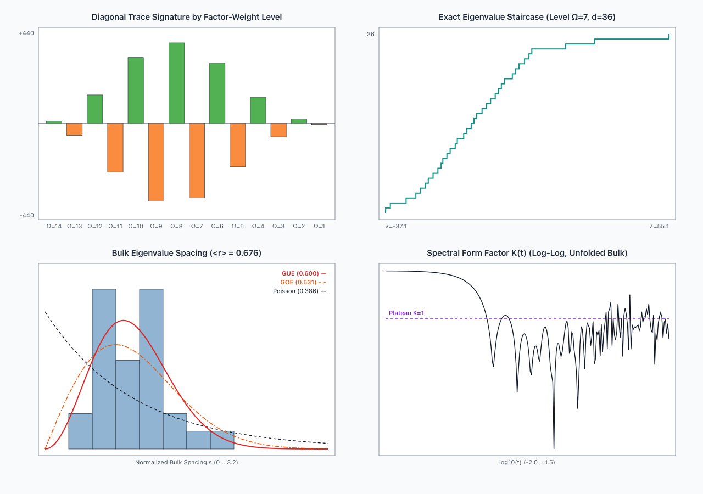
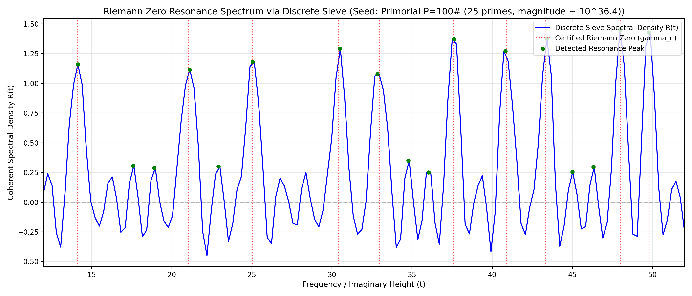

# tensor-sieve

`tensor-sieve` is a Lean 4 proof library and Python experiment suite for studying discrete matrices built from integer prime factorizations. The project asks what eigenvalue statistics those arithmetic matrices produce and how they compare to the spacing of the zeros of the Riemann zeta function.

The non-trivial zeros of the Riemann zeta function repel one another with the same local spacing statistics as eigenvalues of random complex Hermitian matrices (the Gaussian Unitary Ensemble, or GUE). In the Hilbert-Polya approach, one looks for a linear operator tied to arithmetic whose spectrum reflects those zeros. Because arithmetic trace formulas introduce negative signs, the library works in indefinite-metric spaces called Krein spaces, where inner products can take positive or negative values like intervals in Minkowski spacetime.

The Lean 4 modules in `TensorSieve/` and `PTSymmetry/` verify the algebraic symmetries, eigenvalue reality conditions, and graph trace formulas of these discrete operators with zero `sorry` placeholders and zero custom axioms. The Python scripts in `scripts/` diagonalize the matrices numerically and run benchmark comparisons. For an interactive browser version of the matrix calculations, see the companion Rust/WebAssembly app [krein](https://github.com/ryanncode/krein).

## How the Model Works

Pick a composite starting integer, such as `30 = 2 × 3 × 5`, and divide it by each of its distinct prime factors to get a layer ("slice") of divisors (`15, 10, 6`). Repeating that step yields successive horizontal slices in which every integer $x$ has the same total prime-factor count with multiplicity, $\Omega(x) = \sum_p v_p(x)$.

On any slice, `TensorSieve/Operator.lean` builds a complex Hermitian matrix $H$ over all pairs $(a, b)$ in the slice. The real part of $H_{ab}$ depends on the number of prime factors shared by $\gcd(a, b)$ minus the $p$-adic L1 distance $d(a, b) = \sum_p |v_p(a) - v_p(b)|$, and entries drop to zero whenever $d(a, b) > \Omega(\gcd(a, b))$. Off-diagonal entries also carry an imaginary term $\pm i d(a, b)$ whose sign is fixed by whether $a > b$. That imaginary phase keeps $H$ Hermitian ($H^* = H$) while breaking time-reversal symmetry, which is necessary to leave the real-symmetric GOE class and reach GUE-like level spacing.

Each integer also gets a parity sign (`+1` when $\Omega(x)$ is even and `-1` when it is odd), collected into a diagonal involution $J$ to form the Krein operator $C$:

$$J = \mathrm{diag}((-1)^{\Omega(x)}), \qquad C = J H, \qquad J C = C^* J.$$

To measure level repulsion numerically without fragile unfolding fits, the Python probes compute the adjacent spacing ratio $\langle r \rangle = \langle \min(s_n, s_{n+1}) / \max(s_n, s_{n+1}) \rangle$ from sorted eigenvalue gaps $s_n = E_{n+1} - E_n$. Uncorrelated spectra (Poisson) average `0.3863`, time-reversal-symmetric chaotic spectra (GOE) average `0.5307`, and complex Hermitian chaotic spectra (GUE) average `0.5996`.

## Findings from the Proofs and Probes

Every integer inside a single downward slice has the same factor count $\Omega(x)$, so $J = \pm I$ and $C = \pm H$ is Hermitian with purely real eigenvalues (`TensorSieve/Theorem.lean`). Combining two adjacent levels introduces both $+1$ and $-1$ parity sectors, producing a genuinely indefinite Krein space where $C = JH$ keeps exact $J$-self-adjointness while most eigenvalues split into complex conjugate pairs supported on zero-norm (isotropic) eigenvectors (`krein_eigenvalue_real_of_non_isotropic`).

Sparse graphs that only link integers separated by a single prime step factor into independent one-dimensional chains across primes. Even with complex phases or von Mangoldt edge weights $\ln p / \sqrt{p}$, those separable graphs stay in the uncorrelated Poisson regime ($\langle r \rangle \in [0.25, 0.41]$). Observing GUE-like repulsion (for example, $\langle r \rangle = 0.5946$ on the largest slice of `510510`, matching a same-dimension GUE random-matrix control at `0.5962`) requires coupling distinct primes non-separably, as the ordering phase $a > b$ in $H$ does.



Separately from the slice matrices, `scripts/verify_riemann_zeros.py` evaluates the classical Gaussian-smoothed Weil explicit formula over prime powers up to `1000`. That independent check recovers the first 10 Riemann zeta zero heights ($\gamma_1 \approx 14.13$ through $\gamma_{10} \approx 49.77$) with a mean relative error below `0.25%`.



## Quick Start

Fetch the prebuilt Mathlib cache and run the Lean 4 build and test suite:

```bash
lake exe cache get
lake build TensorSieve PTSymmetry
lake env lean --run tests/Tests.lean
```

`tests/Tests.lean` executes all `#guard` checks and runs `#print axioms` on the core theorems to confirm they rely only on Lean's standard axioms (`propext`, `Classical.choice`, `Quot.sound`).

The spacing probe and slice visualizer run with only the Python standard library (switching automatically to NumPy and Matplotlib when installed):

```bash
python3 scripts/adelic_operator_probe.py --max-dim 24 --trials 6
python3 scripts/visualize_spectrum.py
```

The independent Weil explicit-formula benchmark requires NumPy:

```bash
python3 scripts/verify_riemann_zeros.py --primorial 1000 --num-zeros 10
```

## Repository Structure

The verified Lean 4 core lives in `TensorSieve/` and `PTSymmetry/` (compiled under Lean `v4.32.0`). Unproved exploratory sketches (`CondensedMath.lean`, `TopologicalPeriodicCyclicHomology.lean`, `AdelicBridge.lean`, `TatesThesis.lean`) are kept out of the build in `TensorSieve/Speculative/`. The executable entry point `cmd/Main.lean` generates the downward slice CSV in `data/data.csv` for `scripts/visualize_spectrum.py`.

| Module | Proved Results |
|---|---|
| [TensorSieve/Operator.lean](TensorSieve/Operator.lean) | Symmetry of the $p$-adic distance `valuationDivergence`, Hermiticity of the slice matrix $H$, $J^2 = I$, $J$-self-adjointness of $C = JH$, and the Krein reality theorem for non-isotropic eigenvectors ($[v, v]_J \ne 0$). |
| [TensorSieve/Theorem.lean](TensorSieve/Theorem.lean) | Closed-form diagonal entries $(-1)^{\Omega(a)}\Omega(a)$, exact factor drop $\Omega(n/p) = \Omega(n) - 1$ for primes $p \mid n$, exact trace formula $\mathrm{Tr}(H) = (-1)^k k \lvert\text{slice}\rvert$ on constant-weight slices, scalar $J = (-1)^k I$ and Hermiticity of $C$ on single slices, and symmetry of the $p$-adic tree metric on positive integers. |
| [TensorSieve/KreinBridge.lean](TensorSieve/KreinBridge.lean) | Instantiates the abstract `PTSymmetry` Krein-space typeclasses directly on finite slice vector spaces `Fin slice.length → ℝ`, matching the real part of `sliceKreinOperator`. |
| [TensorSieve/DiscreteTrace.lean](TensorSieve/DiscreteTrace.lean) | Unconditional finite prime-step graph trace formula (`concrete_prime_step_selberg_trace`), $\mathrm{Tr}(L_c^2) = \mathrm{Tr}(D^2) + \sum_{p \in P}\sum_{x \in S} \deg_p(x, S)$, along with general matrix-power traces. |
| [TensorSieve/Kinematics.lean](TensorSieve/Kinematics.lean) | Well-founded divisibility ordering and proof that repeated division by minimal prime factors terminates at `1` for every positive integer. |
| [TensorSieve/PunctureMask.lean](TensorSieve/PunctureMask.lean) & [FTNILO.lean](TensorSieve/FTNILO.lean) | Coprimality indicator gates, Möbius inversion expansion, and equivalence between finite integer index contractions and matrix multiplication. |
| [TensorSieve/LambdaRing.lean](TensorSieve/LambdaRing.lean), [F1Descent.lean](TensorSieve/F1Descent.lean) & [GaloisRepresentation.lean](TensorSieve/GaloisRepresentation.lean) | Frobenius-lift $\Lambda$-ring structure on $\mathbb{Z}$ via Fermat's Little Theorem, Adams ring-homomorphism properties, and Krein-isometric group representations. |
| [PTSymmetry/](PTSymmetry/) | Standalone Krein-space library covering Minkowski signature checks, fundamental symmetry $J$, the induced positive-definite Majorant Hilbert space, subspace projections, and Gupta-Bleuler physical subspaces. |
