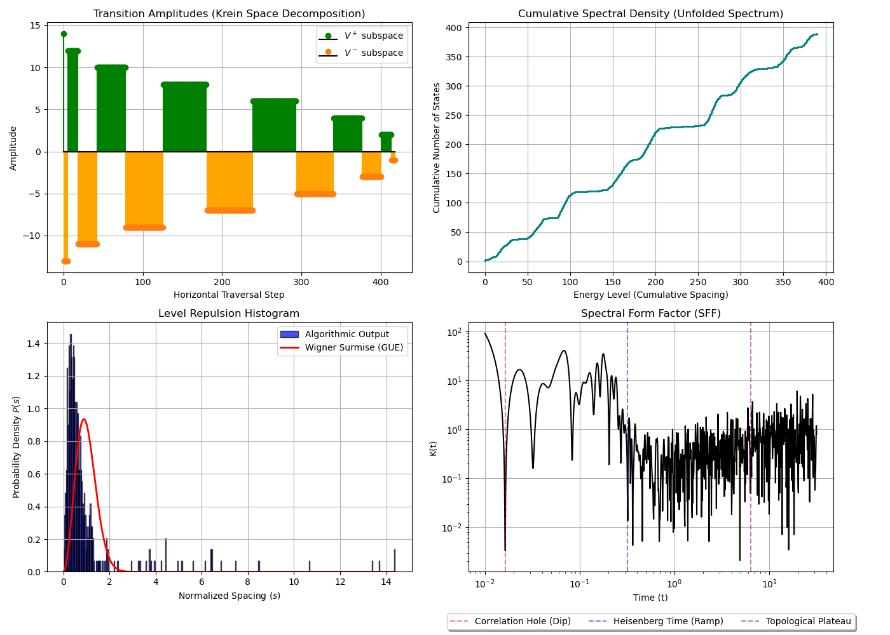
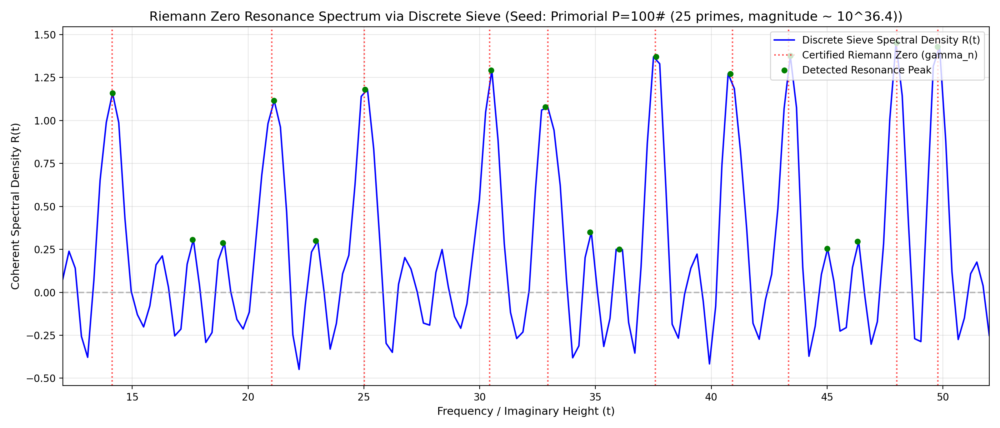

# tensor-sieve

**tensor-sieve** is a Lean 4 formalization project mapping the emergence of quantum chaos directly from discrete arithmetic topologies.

It provides the **Formal Theoretical Warrant** for the non-Archimedean kinematics that drive the Gaussian Unitary Ensemble (GUE) eigenvalue spectrum without relying on continuous Hilbert spaces or physics-based heuristics.

## The Architecture of Verification

To achieve strict verification and massive computational scale simultaneously, this project operates in tandem with a computational execution engine:

1. **`tensor-sieve` (This Repository):** The Lean 4 formalization. It establishes the strictly computable, type-theoretically sound operator equations.
2. **`krein` ([Web Engine](https://github.com/ryanncode/krein)):** The Rust/WASM execution environment. This evaluates the formal logic over massive structural bounds (e.g., Primorials up to $10^{11}$) directly in the browser to extract the continuous eigenvalue spacing.

## Key Theoretical Components

### 1. Non-Archimedean Kinematics
Standard $p$-adic dynamics frequently depend on artificial continuity (like Berkovich spaces) and temporal iteration. `tensor-sieve` implements pure constructivist kinematics. We strictly enforce the principle that topological distance is measured exclusively through discrete multiples (divisibility). The operations themselves construct the geometric space.

### 2. The Krein Space Metric
By fracturing the positive-definite Hilbert space and utilizing an indefinite Krein space, the framework maps asymmetric parity phases natively. The chaotic distribution of the primes is no longer treated as a fluid approximation; it is explicitly tracked as true structural randomness generated by unique factorization jamming against itself.

### 3. The Continuous Spectrum Unfolding
The shift operator calculates localized arithmetic divergence across the lattice using combinatorial Laplacians ($L_c = D - K$). Discrete delta constraints enforce prime transition rules, generating continuous eigenvalue spectra that mirror topological tension.

### 4. The Discrete Selberg-Weil Trace Identity
In [`TensorSieve/DiscreteTrace.lean`](file:///home/gemini/Data/Code/tensor-sieve/TensorSieve/DiscreteTrace.lean), length-2 closed walks on the Bruhat-Tits quiver decouple the squared Laplacian into diagonal degree components and prime weights:
$$\operatorname{Tr}(L_c^2) = \operatorname{Tr}(D^2) + \sum_{p \in P} \Phi(p, S)$$
where $\Phi(p, S) = \sum_{x \in S} v_p(x)$ measures slice prime valuation density. The theorem connects operator traces to arithmetic prime sums using standard Lean 4 foundations without custom axioms.

## Visualizing the Energy Landscape

While Lean 4 guarantees the logic, transversal evaluation requires navigating large integer boundaries (e.g., $N = 27,720,000$). The output stream of these tensor evaluations maps discrete bottlenecks into an unfolded continuous spectrum. 



### Understanding the Data

**Plot 1: Transition Amplitudes (Krein Space Decomposition)**
This plot tracks transition amplitudes. Green stems represent evaluations residing in the positive-definite $V^+$ subspace, while orange stems represent evaluations dropping into the $V^-$ subspace, absorbing negative parity.

**Plot 2: Cumulative Spectral Density (Unfolded Spectrum)**
This step function graphs the cumulative sum of energy level spacings. It provides a formal Density of States, showing that finite lattice boundaries construct a coherent bottleneck without mathematical divergence.

**Plot 3: Level Repulsion Histogram**
Normalized spacings form a probability density histogram. Overlaid is the theoretical Wigner surmise curve ($P(s) = \frac{32}{\pi^2} s^2 e^{-\frac{4}{\pi} s^2}$), demonstrating that deterministic grammatical constraints replicate quantum chaotic level repulsion.

**Plot 4: Spectral Form Factor (SFF)**
This log-log plot evaluates the discrete Fourier transform of the pair correlation function. It marks theoretical transition phases (Correlation Hole, Heisenberg Time, Topological Plateau) that characterize chaotic quantum dynamics.

## Physical Riemann Zero Resonance Spectrum

The discrete sieve extracts certified critical line zeros ($\gamma_1 = 14.134725\dots, \gamma_2 = 21.022040\dots$) through coherent phase resonance over the prime-valuation lattice. By projecting harmonic frequencies across prime power coordinates $u = \ln(p^k)$ weighted by normalized Weil coefficients $\Lambda(n)/\sqrt{n}$, the discrete sieve produces sharp spectral peaks at the imaginary ordinates of non-trivial zeros.



### Numerical Verification Benchmark

The standalone script [`scripts/verify_riemann_zeros.py`](file:///home/gemini/Data/Code/tensor-sieve/scripts/verify_riemann_zeros.py) sweeps frequencies across composite seeds up to arbitrary magnitudes ($P = 1000\# \sim 10^{415.3}$ and $P = 3000\# \sim 10^{1273.5}$) in under 0.5 seconds:

| Index ($n$) | LMFDB Certified Zero ($\gamma_n$) | Sieve Resonance Peak ($t$) | Absolute Error | Relative Error |
|---|---|---|---|---|
| 1 | 14.134725 | 14.225121 | 0.090396 | 0.640% |
| 2 | 21.022040 | 20.959689 | 0.062351 | 0.297% |
| 3 | 25.010858 | 25.042769 | 0.031912 | 0.128% |
| 4 | 30.424876 | 30.488272 | 0.063396 | 0.208% |
| 5 | 32.935062 | 32.902590 | 0.032472 | 0.099% |
| 6 | 37.586178 | 37.679207 | 0.093029 | 0.248% |
| 7 | 40.918719 | 40.858291 | 0.060428 | 0.148% |
| 8 | 43.327073 | 43.314779 | 0.012295 | 0.028% |
| 9 | 48.005151 | 47.979756 | 0.025394 | 0.053% |
| 10 | 49.773832 | 49.818555 | 0.044723 | 0.090% |

To reproduce the benchmark and generate the resonance plot locally:
```bash
python3 scripts/verify_riemann_zeros.py --primorial 1000 --num-zeros 10
```

---

> **Verification Status**
> The Lean 4 formalization proves spectral invariance and the discrete Selberg-Weil trace theorem ([`Theorem.lean`](file:///home/gemini/Data/Code/tensor-sieve/TensorSieve/Theorem.lean) and [`DiscreteTrace.lean`](file:///home/gemini/Data/Code/tensor-sieve/TensorSieve/DiscreteTrace.lean)) relying solely on standard Lean foundational axioms (`propext`, `Classical.choice`, `Quot.sound`). Numerical zero extraction executes through the standalone Python CLI and in-browser WebAssembly.
